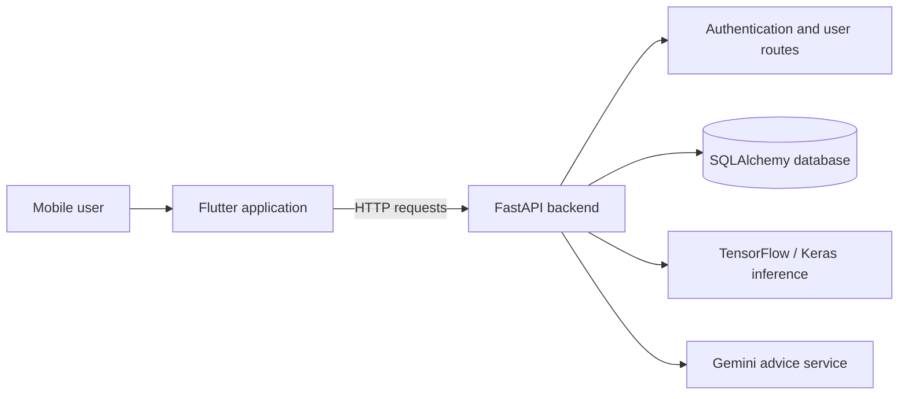

<div align="center">


# DermaScope

**An AI-assisted dermatology awareness mobile app prototype**

Flutter · FastAPI · TensorFlow/Keras · SQLAlchemy · Gemini

Developed by **Team AI-180** during the **Artificial Intelligence and Technology Academy Bootcamp**.

[Original Turkish project report and sprint history](docs/ORIGINAL_PROJECT_REPORT_TR.md)

</div>

## Overview

DermaScope explores how a mobile interface, image analysis models, and an AI-powered advice service can be combined into a dermatology-awareness experience. Users can navigate an analysis workflow, review prototype dashboards, and interact with a conversational advice interface.

**Project scope:** This is an educational research-and-development **prototype**, not a medically validated diagnostic tool. Model outputs and AI-generated guidance should not be interpreted as a medical diagnosis or used to make treatment decisions.

## What the prototype demonstrates

- **Image analysis workflow:** The Flutter application provides camera/image-related screens; the FastAPI backend exposes model inference routes.
- **ML model integration:** Backend prediction code loads Keras `.h5` model files using TensorFlow, with model caching logic.
- **AI-assisted advice:** A Gemini-based service supports informational responses.
- **Account and profile flows:** Authentication and user-related APIs built with FastAPI and SQLAlchemy.
- **Dashboard experience:** UI screens for analysis history, profile details, charts, and wellness-related information.
- **Team-based development:** A collaborative bootcamp project with sprint planning, UI/UX work, backend engineering, and ML experimentation.

> **Implementation note:** Some screens and endpoints use sample data or placeholder responses, including parts of the hair analysis and dashboard experience. The repository should be treated as a working prototype and historical project rather than a production-ready healthcare system.

## Screens and development history

The original project documentation includes mobile and tablet designs, prototype screenshots, model experiments, integration notes, and three sprint reports.

**[View screenshots, sprint retrospectives, and the full original report](docs/ORIGINAL_PROJECT_REPORT_TR.md)**

The original report is preserved unchanged in the repository so the team's work and project history remain available.

## Tech stack

| Area | Technology |
| --- | --- |
| Mobile application | Flutter, Dart |
| UI state management | Provider |
| HTTP and device features | `http`, camera, image_picker |
| Backend framework | Python, FastAPI, Pydantic |
| Persistence and authentication | SQLAlchemy, JWT-oriented authentication code |
| Model integration | TensorFlow / Keras, NumPy, Pillow |
| Language-model integration | Google Gemini |
| Development tooling | Dockerfile for the backend |

## Architecture



### Repository structure

```text
dermoscope_ui/
  lib/
    screens/           Flutter screens and user journeys
    providers/         UI state providers
    services/          Client-side service integrations
    routes/            Navigation routes

dermoscope_backend/
  app/
    routers/           Authentication, user and advice endpoints
    models/            SQLAlchemy models
    schemas/           Request and response schemas
    services/          Business logic and AI integration
    core/              Settings and security helpers
    database/          Database session configuration
  model_api/           Prediction endpoints and local model artifacts
  requirements.txt    Listed Python dependencies
  Dockerfile          Backend container definition

docs/
  ORIGINAL_PROJECT_REPORT_TR.md
```

## Getting started

This is an archived bootcamp prototype. Running every integration requires compatible credentials, model files, and possibly dependency adjustments.

### Flutter app

Install a Flutter SDK compatible with the Dart constraint in `dermoscope_ui/pubspec.yaml` (currently `^3.8.0`), then run:

```bash
git clone https://github.com/AhmetKoca32/AI-180.git
cd AI-180/dermoscope_ui
flutter pub get
flutter run
```

### FastAPI backend

Using Python 3.10 as a starting point (also used by the repository's Dockerfile):

```bash
cd dermoscope_backend
python -m venv .venv
source .venv/bin/activate
pip install -r requirements.txt
uvicorn app.main:app --reload
```

On Windows, activate the virtual environment using the platform-specific activation command.

Create a **local, untracked** `.env` file in `dermoscope_backend/` with application-specific settings such as `DB_URL`, `SECRET_KEY`, and `GEMINI_API_KEY`. Supply your own credentials; never commit actual secrets. The backend settings also include `ACCESS_TOKEN_EXPIRE_MINUTES`.

**Setup caveats:**
- `requirements.txt` is a historical dependency list and may need updating for current environments. For example, the source imports `google.generativeai`, which is not listed in that file.
- Model inference requires the model files and paths expected by `model_api/predict.py`. Some optional paths referenced by code may not exist.
- The commands above are development starting points, **not** a claim that the full app has been freshly built or tested.

## API overview

The FastAPI application registers routes for:

- `/auth` — account registration and login.
- `/user` — user and profile operations, including prototype/test behavior.
- `/model_api` — image/model inference endpoints.
- `/advice` — Gemini-backed informational advice.

The exact request schemas and available operations are defined by the source files in `dermoscope_backend/app/routers/` and `dermoscope_backend/model_api/`.

## Contributors

| Team member | Role recorded in the original project report |
| --- | --- |
| Arda Tezbaşaran | Developer / Data Scientist |
| **Ahmet Koca** | **Backend Developer / UI-UX Designer** |
| İrem Fındık | Scrum Master / Product Owner |
| Edanur Özkan | UI-UX Designer / Developer |
| Murat Köktopçu | Backend Developer / Data Scientist |

The app was developed collaboratively. The roles above reflect the team's own report and do not imply that any one member built the entire system.

## Historical documentation

The project's full Turkish documentation was retained without rewriting its sprint reports, illustrations, meeting notes, or original descriptions:

**[Original Project Report (Turkish)](docs/ORIGINAL_PROJECT_REPORT_TR.md)**

---

**Medical disclaimer:** DermaScope is a student-built prototype for technical exploration and awareness. It is not a regulated medical device, has no demonstrated clinical validation in this repository, and is not a substitute for professional medical evaluation.
